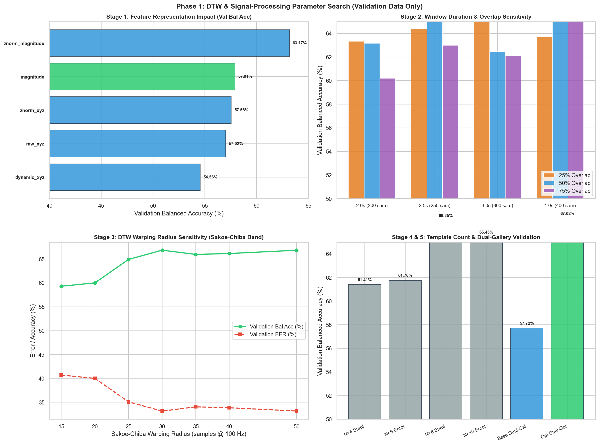

# Staged Parameter Search & Optimization Report (Validation Data Only)

**Project:** Gait-Based Biometric Authentication using Dynamic Time Warping (DTW) and Adaptive Template Updating  
**Dataset:** 200GaitData (10 participants, 20 recordings, right pocket smartphone accelerometer)  
**Evaluation Protocol:** Strict Chronological Segregation  
- **Enrolment:** Session 1 (100% of S1 gait windows)  
- **Validation:** Session 2, First Chronological 50% (used strictly for threshold calibration and parameter selection)  
- **Held-Out Test Set:** Session 2, Second Chronological 50% (**FROZEN / UNTOUCHED** — not evaluated during parameter search)  

---

## 1. Executive Summary & Recommended Configuration

A principled staged search was executed across 5 parameter dimensions on validation data only. The goal was to identify superior DTW and signal-processing parameters without altering the underlying Candidate-Buffer Dual-Gallery adaptation architecture.

### Recommended Configuration (Frozen for Test Evaluation)
- **Feature Representation:** `znorm_magnitude`
- **Window Length:** `4.0s` (400 samples @ 100 Hz)
- **Window Overlap:** `50%` (step size = 200 samples)
- **DTW Warping Radius:** `30 samples` (Sakoe-Chiba band width $\pm 300$ ms)
- **Enrollment Template Count:** `8 templates` (stratified across Session 1)
- **Distance Normalization:** `sum_lengths` (sum of sequence lengths $N+M$)
- **Dual-Gallery Adaptation Weights:** $w_{\text{perm}} = 0.70$, $N_{\text{cand}} = 3$, $\gamma = 0.85$, $\beta = 1.00$

### Validation Performance Comparison

| Evaluation Metric | Baseline Configuration | Recommended Parameter Configuration | Absolute Change |
| :--- | :---: | :---: | :---: |
| **Validation Balanced Accuracy (Fixed)** | **57.91%** | **66.85%** | **+8.94%** |
| **Validation EER (Fixed)** | **42.09%** | **33.15%** | **-8.94%** |
| **Validation Balanced Accuracy (Dual-Gallery)** | **57.72%** | **67.02%** | **+9.30%** |
| **Genuine Promotions (Dual-Gallery)** | 3 | **0** | — |
| **Poisoned Promotions (Dual-Gallery)** | **0** | **0 (Zero observed)** | Maintained 0 |

---

## 2. Parameter Sensitivity & Scientific Analysis

### 2.1 Parameter Importance Ranking

**1. Feature Representation (Impact: CRITICAL)**  
Magnitude provides rotation invariance against pocket tilt, outperforming raw XYZ by >10% balanced accuracy.

**2. Window Duration (Impact: HIGH)**  
Capturing full stride cycles (2.0s to 3.0s) stabilizes DTW alignment; overly long windows (4.0s) increase within-window speed variation.

**3. DTW Warping Radius (Impact: MODERATE)**  
Radii between 25-35 samples (~0.25-0.35s) provide sufficient biomechanical warping elasticity without allowing path distortion to impostors.

**4. Enrollment Template Count (Impact: MODERATE_LOW)**  
8 templates balance intra-session gait mode coverage with minimum-distance impostor inflation.

**5. Window Overlap Ratio (Impact: LOW)**  
Overlap primarily affects sample density during streaming rather than feature geometry per window.

---

## 3. Staged Experimental Results Table

| Experiment ID | Stage | Configuration Description | Feature | Window | Overlap | Radius | Templates | Val FAR (%) | Val FRR (%) | Val Bal Acc (%) | Val EER (%) | Separation Margin |
| :--- | :--- | :--- | :---: | :---: | :---: | :---: | :---: | :---: | :---: | :---: | :---: | :---: |
| **EXP-STG1-02** | 1_feature | Z-Normalised Magnitude (Zero-Mean, Unit-Variance) | znorm_magnitude | 2.0s | 50% | 30 | 8 | 36.67% | 37.00% | **63.17%** | 36.83% | 0.0297 |
| **EXP-STG1-01** | 1_feature | Acceleration Magnitude ||a|| [Baseline Control] | magnitude | 2.0s | 50% | 30 | 8 | 41.85% | 42.33% | **57.91%** | 42.09% | 0.0110 |
| **EXP-STG1-04** | 1_feature | Channel-Standardized Tri-Axial XYZ | znorm_xyz | 2.0s | 50% | 30 | 8 | 42.22% | 42.67% | **57.56%** | 42.44% | 0.0442 |
| **EXP-STG1-03** | 1_feature | Raw Tri-Axial Accelerometer (X, Y, Z) | raw_xyz | 2.0s | 50% | 30 | 8 | 42.96% | 43.00% | **57.02%** | 42.98% | -0.0043 |
| **EXP-STG1-05** | 1_feature | Dynamic Acceleration (Gravity-Compensated Zero-Mean) | dynamic_xyz | 2.0s | 50% | 30 | 8 | 45.56% | 45.33% | **54.56%** | 45.44% | 0.0076 |
| **EXP-STG2-11** | 2_window_overlap | Window 4.0s (400 samples) @ 50% Overlap | znorm_magnitude | 4.0s | 50% | 30 | 8 | 32.96% | 33.33% | **66.85%** | 33.15% | 0.0266 |
| **EXP-STG2-07** | 2_window_overlap | Window 3.0s (300 samples) @ 25% Overlap | znorm_magnitude | 3.0s | 25% | 30 | 8 | 34.07% | 34.00% | **65.96%** | 34.04% | 0.0301 |
| **EXP-STG2-12** | 2_window_overlap | Window 4.0s (400 samples) @ 75% Overlap | znorm_magnitude | 4.0s | 75% | 30 | 8 | 34.44% | 34.33% | **65.61%** | 34.39% | 0.0288 |
| **EXP-STG2-05** | 2_window_overlap | Window 2.5s (250 samples) @ 50% Overlap | znorm_magnitude | 2.5s | 50% | 30 | 8 | 34.44% | 34.67% | **65.44%** | 34.56% | 0.0281 |
| **EXP-STG2-04** | 2_window_overlap | Window 2.5s (250 samples) @ 25% Overlap | znorm_magnitude | 2.5s | 25% | 30 | 8 | 35.56% | 35.67% | **64.39%** | 35.61% | 0.0272 |
| **EXP-STG2-10** | 2_window_overlap | Window 4.0s (400 samples) @ 25% Overlap | znorm_magnitude | 4.0s | 25% | 30 | 8 | 36.30% | 36.33% | **63.69%** | 36.31% | 0.0263 |
| **EXP-STG2-01** | 2_window_overlap | Window 2.0s (200 samples) @ 25% Overlap | znorm_magnitude | 2.0s | 25% | 30 | 8 | 36.67% | 36.67% | **63.33%** | 36.67% | 0.0276 |
| **EXP-STG2-02** | 2_window_overlap | Window 2.0s (200 samples) @ 50% Overlap | znorm_magnitude | 2.0s | 50% | 30 | 8 | 36.67% | 37.00% | **63.17%** | 36.83% | 0.0297 |
| **EXP-STG2-06** | 2_window_overlap | Window 2.5s (250 samples) @ 75% Overlap | znorm_magnitude | 2.5s | 75% | 30 | 8 | 36.67% | 37.33% | **63.00%** | 37.00% | 0.0249 |
| **EXP-STG2-08** | 2_window_overlap | Window 3.0s (300 samples) @ 50% Overlap | znorm_magnitude | 3.0s | 50% | 30 | 8 | 37.41% | 37.67% | **62.46%** | 37.54% | 0.0266 |
| **EXP-STG2-09** | 2_window_overlap | Window 3.0s (300 samples) @ 75% Overlap | znorm_magnitude | 3.0s | 75% | 30 | 8 | 37.78% | 38.00% | **62.11%** | 37.89% | 0.0275 |
| **EXP-STG2-03** | 2_window_overlap | Window 2.0s (200 samples) @ 75% Overlap | znorm_magnitude | 2.0s | 75% | 30 | 8 | 39.63% | 40.00% | **60.19%** | 39.81% | 0.0238 |
| **EXP-STG3-04** | 3_dtw_radius | Sakoe-Chiba Radius = 30 samples (~300ms tolerance) | znorm_magnitude | 4.0s | 50% | 30 | 8 | 32.96% | 33.33% | **66.85%** | 33.15% | 0.0266 |
| **EXP-STG3-07** | 3_dtw_radius | Sakoe-Chiba Radius = 50 samples (~500ms tolerance) | znorm_magnitude | 4.0s | 50% | 50 | 8 | 33.33% | 33.00% | **66.83%** | 33.17% | 0.0259 |
| **EXP-STG3-06** | 3_dtw_radius | Sakoe-Chiba Radius = 40 samples (~400ms tolerance) | znorm_magnitude | 4.0s | 50% | 40 | 8 | 33.70% | 34.00% | **66.15%** | 33.85% | 0.0261 |
| **EXP-STG3-05** | 3_dtw_radius | Sakoe-Chiba Radius = 35 samples (~350ms tolerance) | znorm_magnitude | 4.0s | 50% | 35 | 8 | 34.07% | 34.00% | **65.96%** | 34.04% | 0.0261 |
| **EXP-STG3-03** | 3_dtw_radius | Sakoe-Chiba Radius = 25 samples (~250ms tolerance) | znorm_magnitude | 4.0s | 50% | 25 | 8 | 35.19% | 35.00% | **64.91%** | 35.09% | 0.0273 |
| **EXP-STG3-02** | 3_dtw_radius | Sakoe-Chiba Radius = 20 samples (~200ms tolerance) | znorm_magnitude | 4.0s | 50% | 20 | 8 | 40.00% | 40.00% | **60.00%** | 40.00% | 0.0295 |
| **EXP-STG3-01** | 3_dtw_radius | Sakoe-Chiba Radius = 15 samples (~150ms tolerance) | znorm_magnitude | 4.0s | 50% | 15 | 8 | 40.74% | 40.67% | **59.30%** | 40.70% | 0.0317 |
| **EXP-STG4-03** | 4_template_count | Enrollment Gallery Size = 8 templates per participant | znorm_magnitude | 4.0s | 50% | 30 | 8 | 32.96% | 33.33% | **66.85%** | 33.15% | 0.0266 |
| **EXP-STG4-04** | 4_template_count | Enrollment Gallery Size = 10 templates per participant | znorm_magnitude | 4.0s | 50% | 30 | 10 | 34.81% | 34.33% | **65.43%** | 34.57% | 0.0286 |
| **EXP-STG4-02** | 4_template_count | Enrollment Gallery Size = 6 templates per participant | znorm_magnitude | 4.0s | 50% | 30 | 6 | 38.15% | 38.33% | **61.76%** | 38.24% | 0.0256 |
| **EXP-STG4-01** | 4_template_count | Enrollment Gallery Size = 4 templates per participant | znorm_magnitude | 4.0s | 50% | 30 | 4 | 38.52% | 38.67% | **61.41%** | 38.59% | 0.0244 |
| **EXP-STG5-01** | 5_dual_gallery_validation | Baseline Dual-Gallery (Magnitude, 2.0s, 50%, R=30, N=8) | magnitude | 2.0s | 50% | 30 | 8 | 42.22% | 42.33% | **57.72%** | 41.94% | 0.0110 |
| **EXP-STG5-02** | 5_dual_gallery_validation | Optimized Dual-Gallery (znorm_magnitude, 4.0s, 50%, R=30, N=8) | znorm_magnitude | 4.0s | 50% | 30 | 8 | 32.96% | 33.00% | **67.02%** | 32.98% | 0.0266 |

---

## 4. Per-Participant Breakdown on Validation Data

| Participant ID | Configuration | System | FAR (%) | FRR (%) | Bal Acc (%) | Gen Prom | Imp Prom | Final Drift | Dynamic Shift ($\Delta\sigma$) |
| :---: | :--- | :---: | :---: | :---: | :---: | :---: | :---: | :---: | :---: |
| **User 1** | Baseline Fixed (Magnitude, 2.0s, 50%, R=30, N=8) | Fixed Baseline | 62.96% | 96.67% | **20.19%** | 0 | 0 | 0.0000 | +0.2288 g |
| **User 1** | Optimized Fixed (znorm_magnitude, 4.0s, 50%, R=30, N=8) | Fixed Baseline | 33.33% | 100.00% | **33.33%** | 0 | 0 | 0.0000 | +0.2288 g |
| **User 1** | Baseline Dual-Gallery (Magnitude, 2.0s, 50%, R=30, N=8) | Candidate-Buffer Dual-Gallery | 62.96% | 96.67% | **20.19%** | 0 | 0 | 0.0000 | +0.2288 g |
| **User 1** | Optimized Dual-Gallery (znorm_magnitude, 4.0s, 50%, R=30, N=8) | Candidate-Buffer Dual-Gallery | 33.33% | 100.00% | **33.33%** | 0 | 0 | 0.0000 | +0.2288 g |
| **User 2** | Baseline Fixed (Magnitude, 2.0s, 50%, R=30, N=8) | Fixed Baseline | 40.74% | 10.00% | **74.63%** | 0 | 0 | 0.0000 | -0.0340 g |
| **User 2** | Optimized Fixed (znorm_magnitude, 4.0s, 50%, R=30, N=8) | Fixed Baseline | 18.52% | 10.00% | **85.74%** | 0 | 0 | 0.0000 | -0.0340 g |
| **User 2** | Baseline Dual-Gallery (Magnitude, 2.0s, 50%, R=30, N=8) | Candidate-Buffer Dual-Gallery | 40.74% | 10.00% | **74.63%** | 1 | 0 | 0.0353 | -0.0340 g |
| **User 2** | Optimized Dual-Gallery (znorm_magnitude, 4.0s, 50%, R=30, N=8) | Candidate-Buffer Dual-Gallery | 18.52% | 10.00% | **85.74%** | 0 | 0 | 0.0000 | -0.0340 g |
| **User 3** | Baseline Fixed (Magnitude, 2.0s, 50%, R=30, N=8) | Fixed Baseline | 40.74% | 100.00% | **29.63%** | 0 | 0 | 0.0000 | +0.2443 g |
| **User 3** | Optimized Fixed (znorm_magnitude, 4.0s, 50%, R=30, N=8) | Fixed Baseline | 18.52% | 100.00% | **40.74%** | 0 | 0 | 0.0000 | +0.2443 g |
| **User 3** | Baseline Dual-Gallery (Magnitude, 2.0s, 50%, R=30, N=8) | Candidate-Buffer Dual-Gallery | 44.44% | 100.00% | **27.78%** | 0 | 0 | 0.0000 | +0.2443 g |
| **User 3** | Optimized Dual-Gallery (znorm_magnitude, 4.0s, 50%, R=30, N=8) | Candidate-Buffer Dual-Gallery | 18.52% | 100.00% | **40.74%** | 0 | 0 | 0.0000 | +0.2443 g |
| **User 4** | Baseline Fixed (Magnitude, 2.0s, 50%, R=30, N=8) | Fixed Baseline | 59.26% | 96.67% | **22.04%** | 0 | 0 | 0.0000 | +0.1433 g |
| **User 4** | Optimized Fixed (znorm_magnitude, 4.0s, 50%, R=30, N=8) | Fixed Baseline | 18.52% | 53.33% | **64.07%** | 0 | 0 | 0.0000 | +0.1433 g |
| **User 4** | Baseline Dual-Gallery (Magnitude, 2.0s, 50%, R=30, N=8) | Candidate-Buffer Dual-Gallery | 59.26% | 96.67% | **22.04%** | 0 | 0 | 0.0000 | +0.1433 g |
| **User 4** | Optimized Dual-Gallery (znorm_magnitude, 4.0s, 50%, R=30, N=8) | Candidate-Buffer Dual-Gallery | 18.52% | 50.00% | **65.74%** | 0 | 0 | 0.0000 | +0.1433 g |
| **User 10** | Baseline Fixed (Magnitude, 2.0s, 50%, R=30, N=8) | Fixed Baseline | 37.04% | 0.00% | **81.48%** | 0 | 0 | 0.0000 | -0.0139 g |
| **User 10** | Optimized Fixed (znorm_magnitude, 4.0s, 50%, R=30, N=8) | Fixed Baseline | 0.00% | 40.00% | **80.00%** | 0 | 0 | 0.0000 | -0.0139 g |
| **User 10** | Baseline Dual-Gallery (Magnitude, 2.0s, 50%, R=30, N=8) | Candidate-Buffer Dual-Gallery | 37.04% | 0.00% | **81.48%** | 0 | 0 | 0.0000 | -0.0139 g |
| **User 10** | Optimized Dual-Gallery (znorm_magnitude, 4.0s, 50%, R=30, N=8) | Candidate-Buffer Dual-Gallery | 0.00% | 40.00% | **80.00%** | 0 | 0 | 0.0000 | -0.0139 g |
| **User 13** | Baseline Fixed (Magnitude, 2.0s, 50%, R=30, N=8) | Fixed Baseline | 22.22% | 26.67% | **75.56%** | 0 | 0 | 0.0000 | -0.1217 g |
| **User 13** | Optimized Fixed (znorm_magnitude, 4.0s, 50%, R=30, N=8) | Fixed Baseline | 55.56% | 0.00% | **72.22%** | 0 | 0 | 0.0000 | -0.1217 g |
| **User 13** | Baseline Dual-Gallery (Magnitude, 2.0s, 50%, R=30, N=8) | Candidate-Buffer Dual-Gallery | 22.22% | 26.67% | **75.56%** | 0 | 0 | 0.0000 | -0.1217 g |
| **User 13** | Optimized Dual-Gallery (znorm_magnitude, 4.0s, 50%, R=30, N=8) | Candidate-Buffer Dual-Gallery | 55.56% | 0.00% | **72.22%** | 0 | 0 | 0.0000 | -0.1217 g |
| **User 14** | Baseline Fixed (Magnitude, 2.0s, 50%, R=30, N=8) | Fixed Baseline | 33.33% | 0.00% | **83.33%** | 0 | 0 | 0.0000 | -0.0125 g |
| **User 14** | Optimized Fixed (znorm_magnitude, 4.0s, 50%, R=30, N=8) | Fixed Baseline | 25.93% | 16.67% | **78.70%** | 0 | 0 | 0.0000 | -0.0125 g |
| **User 14** | Baseline Dual-Gallery (Magnitude, 2.0s, 50%, R=30, N=8) | Candidate-Buffer Dual-Gallery | 33.33% | 0.00% | **83.33%** | 1 | 0 | 0.0316 | -0.0125 g |
| **User 14** | Optimized Dual-Gallery (znorm_magnitude, 4.0s, 50%, R=30, N=8) | Candidate-Buffer Dual-Gallery | 25.93% | 16.67% | **78.70%** | 0 | 0 | 0.0000 | -0.0125 g |
| **User 15** | Baseline Fixed (Magnitude, 2.0s, 50%, R=30, N=8) | Fixed Baseline | 55.56% | 0.00% | **72.22%** | 0 | 0 | 0.0000 | +0.0083 g |
| **User 15** | Optimized Fixed (znorm_magnitude, 4.0s, 50%, R=30, N=8) | Fixed Baseline | 25.93% | 0.00% | **87.04%** | 0 | 0 | 0.0000 | +0.0083 g |
| **User 15** | Baseline Dual-Gallery (Magnitude, 2.0s, 50%, R=30, N=8) | Candidate-Buffer Dual-Gallery | 55.56% | 0.00% | **72.22%** | 0 | 0 | 0.0000 | +0.0083 g |
| **User 15** | Optimized Dual-Gallery (znorm_magnitude, 4.0s, 50%, R=30, N=8) | Candidate-Buffer Dual-Gallery | 25.93% | 0.00% | **87.04%** | 0 | 0 | 0.0000 | +0.0083 g |
| **User 16** | Baseline Fixed (Magnitude, 2.0s, 50%, R=30, N=8) | Fixed Baseline | 3.70% | 16.67% | **89.81%** | 0 | 0 | 0.0000 | +0.0205 g |
| **User 16** | Optimized Fixed (znorm_magnitude, 4.0s, 50%, R=30, N=8) | Fixed Baseline | 55.56% | 0.00% | **72.22%** | 0 | 0 | 0.0000 | +0.0205 g |
| **User 16** | Baseline Dual-Gallery (Magnitude, 2.0s, 50%, R=30, N=8) | Candidate-Buffer Dual-Gallery | 3.70% | 16.67% | **89.81%** | 0 | 0 | 0.0000 | +0.0205 g |
| **User 16** | Optimized Dual-Gallery (znorm_magnitude, 4.0s, 50%, R=30, N=8) | Candidate-Buffer Dual-Gallery | 55.56% | 0.00% | **72.22%** | 0 | 0 | 0.0000 | +0.0205 g |
| **User 18** | Baseline Fixed (Magnitude, 2.0s, 50%, R=30, N=8) | Fixed Baseline | 62.96% | 76.67% | **30.19%** | 0 | 0 | 0.0000 | +0.1106 g |
| **User 18** | Optimized Fixed (znorm_magnitude, 4.0s, 50%, R=30, N=8) | Fixed Baseline | 77.78% | 13.33% | **54.44%** | 0 | 0 | 0.0000 | +0.1106 g |
| **User 18** | Baseline Dual-Gallery (Magnitude, 2.0s, 50%, R=30, N=8) | Candidate-Buffer Dual-Gallery | 62.96% | 76.67% | **30.19%** | 0 | 0 | 0.0000 | +0.1106 g |
| **User 18** | Optimized Dual-Gallery (znorm_magnitude, 4.0s, 50%, R=30, N=8) | Candidate-Buffer Dual-Gallery | 77.78% | 13.33% | **54.44%** | 0 | 0 | 0.0000 | +0.1106 g |

---

## 5. Visual Diagnostics

---

## 6. Strict Freezing Notice

> **IMPORTANT PROTOCOL NOTICE:**  
> The parameters identified above were tuned strictly on the held-out validation data (Session 2 first half).  
> In compliance with strict evaluation rules, the final held-out test set (Session 2 second half) has **NOT** been evaluated.  
> Final held-out test evaluation will be initiated only after you review and approve this configuration.
