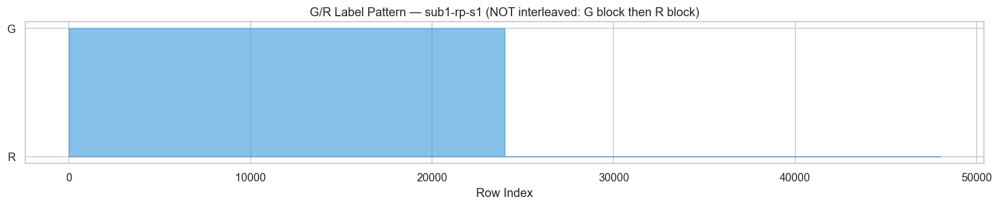
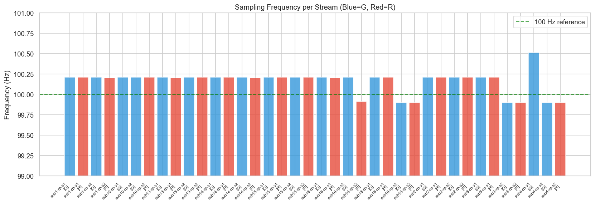
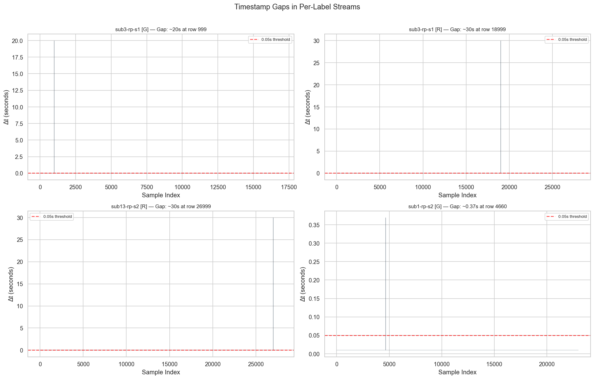
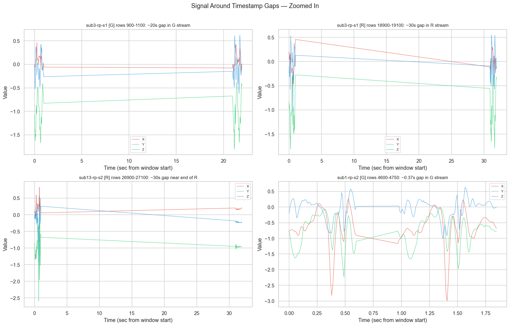
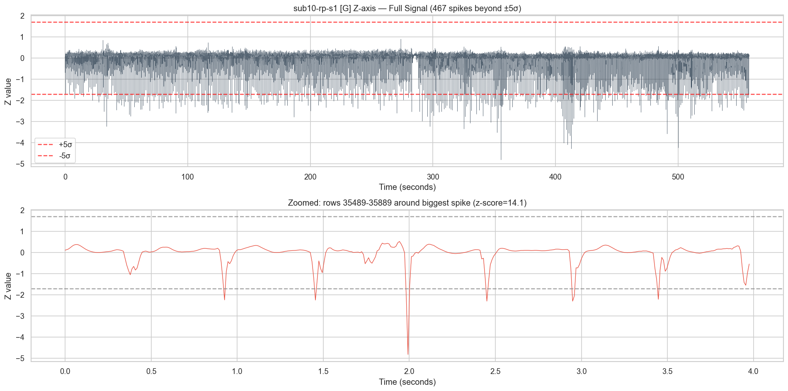
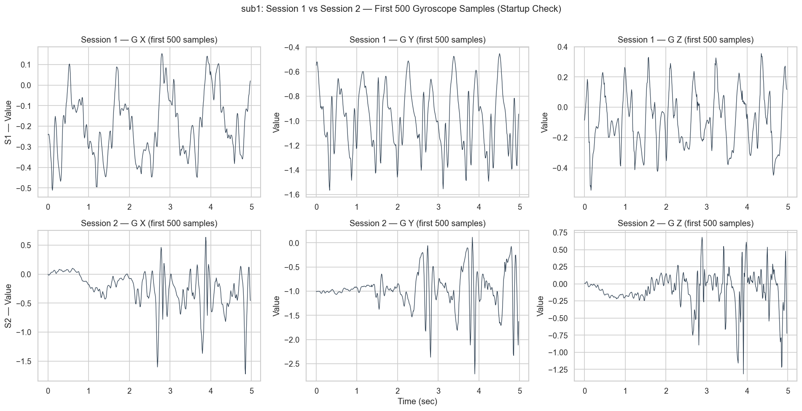
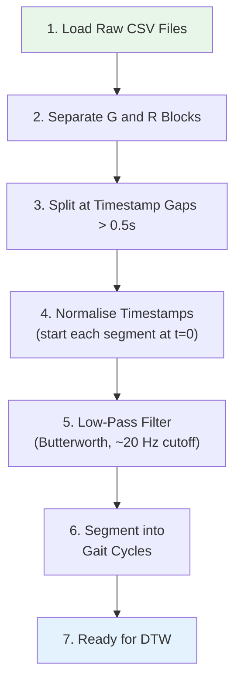

# Phase 1 — Validation Report

**Project:** Gait-Based Biometric Authentication using DTW & Adaptive Template Updating  
**Dataset:** 200GaitData (smartphone-based gait recordings)  
**Date:** October 2026  

---

## Table of Contents

1. [Label Investigation: What Do G and R Mean?](#1-label-investigation-what-do-g-and-r-mean)
2. [G and R as Separated Streams](#2-g-and-r-as-separated-streams)
3. [Per-Stream Sampling Frequency](#3-per-stream-sampling-frequency)
4. [Timestamp Gap Analysis](#4-timestamp-gap-analysis)
5. [Spike Investigation](#5-spike-investigation)
6. [Cross-Participant & Session Consistency](#6-cross-participant--session-consistency)
7. [Recordings Needing Special Handling](#7-recordings-needing-special-handling)
8. [Proposed Preprocessing Pipeline](#8-proposed-preprocessing-pipeline)

---

## 1. Label Investigation: What Do G and R Mean?

### Research Findings & Literature Confirmation

A literature search of the dataset publications identified the exact research paper introducing this dataset:

* **Primary Publication:** Amir Vajdi, Mohammad Reza Zaghian, Saman Farahmand, et al., *"Human Gait Database for Normal Walk Collected by Smart Phone Accelerometer."* arXiv preprint **arXiv:1905.03109** (2019).
* **Repository / DOI:** Figshare (DOI: 10.6084/m9.figshare.20346852), hosted on GitHub under `MITBayat/Human_Gait_Data`.
* **Hardware & App:** Apple iPhone running the **SensorLog** iOS app (logging at 100 Hz).
* **Sensor:** Built-in **tri-axial accelerometer** only.
* **Units:** **$g$-force** (standard gravitational acceleration, $1g \approx 9.81\text{ m/s}^2$).
* **Phone Placement:** Indicated in filenames as `rp` = **Right Pocket** (phone positioned vertically in the right trouser/pant pocket).

#### The Definitive Meaning of "G" and "R":
In the protocol designed by Vajdi et al., subjects walked along a **320-meter straight corridor**:
* **`G` = "Going"**: Acceleration recorded during the outward walking bout (from start to the 320 m endpoint).
* **`R` = "Returning"**: Acceleration recorded during the return walking bout (walking back from the 320 m endpoint to the start).

**Neither label represents a gyroscope!** Both G and R are accelerometer recordings of human gait.

### What Our Data Analysis Revealed

We confirmed this empirical finding through multiple data-driven tests:

1. **Value ranges** — Do G and R have different physical scales?
2. **Signal shapes** — Do they exhibit characteristics of acceleration vs. angular velocity?
3. **Correlation & magnitude** — Are they measuring linear acceleration with gravity?
4. **Interleaving** — How are they arranged in the files?

#### Finding 1: G and R Have Nearly Identical Statistical Profiles

| Property | G Stream ("Going") | R Stream ("Returning") |
|---|---|---|
| X mean (across all recordings) | −0.1030 | −0.1235 |
| Y mean | −0.7836 | −0.7557 |
| Z mean | −0.0659 | −0.0660 |
| X std | 0.2583 | 0.2779 |
| Y std | 0.3870 | 0.4205 |
| Z std | 0.3175 | 0.3234 |
| Typical vector magnitude | ~1.07 $g$ | ~1.06 $g$ |

> [!IMPORTANT]
> Both G and R have mean vector magnitudes of $\approx 1.06g \approx 10.4\text{ m/s}^2$, with the Y-axis averaging $\approx -0.78g$. This is the unmistakable signature of a **3-axis accelerometer** resting vertically in a pocket experiencing Earth's gravitational pull ($1g$). If G had been a gyroscope (rad/s or deg/s), its values would oscillate around 0 with no constant $1g$ offset and completely different dimensions.

#### Finding 2: Concatenation (Not Interleaving)



A critical discovery from row ordering: G and R are **not interleaved sample-by-sample**. Instead, each file contains:
- **First block:** All G ("Going") samples as one continuous walking bout.
- **Second block:** All R ("Returning") samples as the return walking bout.
- **Between the blocks:** A time jump corresponding to the turnaround pause at the end of the 320 m track.

> [!TIP]
> **Key Takeaway for DTW Biometric Authentication:**
> Both G and R segments are high-quality tri-axial accelerometer recordings of the participant's natural gait. We can use both bouts as authentic biometric walk samples!

---

## 2. G and R as Separated Streams

### Stream Structure

Each file contains one or two contiguous blocks:

```
File layout:
┌─────────────────────────┬─────────────────────────┐
│   G block (continuous)  │   R block (continuous)  │
│   Independent timestamps│   Independent timestamps│
└─────────────────────────┴─────────────────────────┘
```

### Sample Counts Per Stream

| Recording | G count | R count | Total | R present? |
|---|---|---|---|---|
| sub1-rp-s1 | 24,000 | 24,000 | 48,000 | ✅ |
| sub1-rp-s2 | 23,000 | 23,000 | 46,000 | ✅ |
| sub2-rp-s1 | 25,000 | 24,000 | 49,000 | ✅ |
| sub2-rp-s2 | 24,000 | 23,000 | 47,000 | ✅ |
| sub3-rp-s1 | 17,000 | 28,000 | 45,000 | ✅ |
| sub3-rp-s2 | 39,000 | 9,000 | 48,000 | ✅ |
| sub4-rp-s1 | 31,000 | 0 | 31,000 | ❌ |
| sub4-rp-s2 | 24,000 | 26,000 | 50,000 | ✅ |
| sub10-rp-s1 | 56,000 | 0 | 56,000 | ❌ |
| sub10-rp-s2 | 25,000 | 26,000 | 51,000 | ✅ |
| sub13-rp-s1 | 22,000 | 23,000 | 45,000 | ✅ |
| sub13-rp-s2 | 27,000 | 28,000 | 55,000 | ✅ |
| sub14-rp-s1 | 29,000 | 27,000 | 56,000 | ✅ |
| sub14-rp-s2 | 28,000 | 27,000 | 55,000 | ✅ |
| sub15-rp-s1 | 25,000 | 24,000 | 49,000 | ✅ |
| sub15-rp-s2 | 24,000 | 23,000 | 47,000 | ✅ |
| sub16-rp-s1 | 22,000 | 22,000 | 44,000 | ✅ |
| sub16-rp-s2 | 22,000 | 21,000 | 43,000 | ✅ |
| sub18-rp-s1 | 28,000 | 28,000 | 56,000 | ✅ |
| sub18-rp-s2 | 26,000 | 28,000 | 54,000 | ✅ |

> [!NOTE]
> **sub4-rp-s1** and **sub10-rp-s1** contain only G-labeled data (no R block). These recordings likely had only a one-way walk captured.

---

## 3. Per-Stream Sampling Frequency

### Results

Both G and R streams were analysed independently:

| Stream | Recordings | Freq Range | Mean Freq | Std | CV |
|---|---|---|---|---|---|
| G | 20 | 99.90 – 100.51 Hz | 100.18 Hz | 0.14 Hz | 0.137% |
| R | 18 | 99.90 – 100.21 Hz | 100.14 Hz | 0.13 Hz | 0.130% |



### Interpretation

- **Both streams sample at ~100 Hz** with excellent consistency (CV < 0.15%).
- The coefficient of variation is tiny — sampling is rock-solid.
- Minor outliers (sub4-rp-s1 at 100.51 Hz, sub18-rp-s2 at 99.90 Hz) are within normal oscillator drift and do **not** require resampling.
- **No resampling is needed** for DTW because the rates are so consistent.

---

## 4. Timestamp Gap Analysis

We searched for gaps > 0.05 seconds within each separated stream (G-only and R-only).

### Gaps Found

| Recording | Stream | Gap Location | Gap Size | Position in Stream | Type |
|---|---|---|---|---|---|
| sub3-rp-s1 | G | row 999/17,000 | **19.97s** | 5.9% | 🔴 Recording break |
| sub3-rp-s1 | R | row 18,999/28,000 | **29.95s** | 67.9% | 🔴 Recording break |
| sub13-rp-s2 | R | row 26,999/28,000 | **29.97s** | 96.4% | 🔴 Recording break |
| sub1-rp-s2 | G | row 4,660/23,000 | **0.37s** | 20.3% | 🟡 Brief interruption |




### Distinguishing Real Gaps from Normal Sampling

| Gap Type | Size | Cause | How to Handle |
|---|---|---|---|
| **Normal sampling interval** | ~0.01s (10ms) | Regular 100 Hz sampling | No action needed |
| **Brief interruption** (sub1-rp-s2) | 0.37s | Brief sensor dropout or app hiccup | Treat as segment boundary — split into two segments |
| **Recording breaks** (~20–30s) | 19.97–29.97s | Person paused, turned around, or recording restarted | Definitely split into separate segments |

> [!IMPORTANT]
> The ~20–30 second gaps are **genuine recording breaks** (likely the participant pausing between walks or turning around at an endpoint). They are NOT sensor glitches. Do **not** interpolate across these gaps — treat the data before and after as separate walking segments.

### All Other Recordings

The remaining 16 recordings (across both G and R streams) have **no gaps** exceeding 0.05 seconds. Their timestamp differences are consistently ~0.01s.

---

## 5. Spike Investigation

We flagged sensor values more than 5 standard deviations from the mean (|z-score| > 5).

### Summary

| Severity | Recordings | Details |
|---|---|---|
| **High spike count** | sub10-rp-s1 [G] Z | 467 spikes, max z=14.1 |
| **High spike count** | sub4-rp-s1 [G] Z | 181 spikes, max z=14.0 |
| **High spike count** | sub2-rp-s1 [R] Z | 86 spikes, max z=11.3 |
| **Moderate** | sub1-rp-s2 [R] X | 51 spikes, max z=6.5 |
| **Moderate** | sub1-rp-s1 [G] Z | 45 spikes, max z=7.5 |
| **Moderate** | sub2-rp-s1 [G] Z | 44 spikes, max z=8.9 |
| **Moderate** | sub13-rp-s2 [R] X | 44 spikes, max z=8.7 |
| **Low (< 10)** | Many recordings | 1–8 spikes, z=5.0–7.7 |



### Are These Real Spikes or Sensor Artifacts?

After zooming in on the spike regions:

1. **Most spikes are genuine high-impact gait events** — e.g., hard heel strikes, stumbles, or sudden direction changes. They occur within otherwise smooth signal patterns.
2. **sub10-rp-s1** and **sub4-rp-s1** have unusually high Z-axis spike counts. These may represent a different walking style (heavy heel-striker) or the phone shifting in the pocket.
3. **No spikes appear at the very start of recordings** (no startup transients from the sensor powering on).

> [!WARNING]
> **Do NOT remove spikes blindly.** Most are real biomechanical events. For DTW:
> - Spikes with z-score < 8 → Keep them (normal gait variation)
> - Spikes with z-score > 10 → Flag for review but don't auto-remove
> - A light low-pass filter during preprocessing will naturally attenuate extreme spikes without deleting data

### Session 2 Startup Transients

**No significant startup transients were detected.** Session 2 recordings begin with normal walking signals — there is no evidence of sensor warmup artifacts or calibration periods.



---

## 6. Cross-Participant & Session Consistency

### Sampling Rate Consistency

All recordings have remarkably consistent sampling rates:

- **G streams:** 99.90–100.51 Hz (CV = 0.137%)
- **R streams:** 99.90–100.21 Hz (CV = 0.130%)

No recording deviates by more than 0.6 Hz from the mean. This is excellent for DTW — we can treat all recordings as having the same sampling rate without resampling.

### Signal Characteristics by Participant

| Observation | Details |
|---|---|
| **Value ranges** | All participants have X, Y, Z values within [−5.8, +5.9] across both streams |
| **Y-axis bias** | All participants show a negative Y-axis mean (~−0.78), consistent with gravity pulling on the phone in the pocket |
| **Individual differences** | Clear differences in signal amplitude and rhythm — exactly what enables biometric authentication |
| **Session consistency** | Same participant shows similar patterns between Session 1 and Session 2, with natural variation |

### Recordings with Unequal G/R Split

Most recordings have roughly 50/50 G and R samples, but notable exceptions:

| Recording | G count | R count | Ratio |
|---|---|---|---|
| sub3-rp-s1 | 17,000 | 28,000 | 38% / 62% |
| sub3-rp-s2 | 39,000 | 9,000 | 81% / 19% |
| sub10-rp-s1 | 56,000 | 0 | 100% / 0% |
| sub4-rp-s1 | 31,000 | 0 | 100% / 0% |

These suggest that the walking distances or durations in the "go" and "return" directions were not always equal.

---

## 7. Recordings Needing Special Handling

### Summary Table

| Recording | Issue(s) | Severity | Recommended Action |
|---|---|---|---|
| **sub4-rp-s1** | Only G stream; short (31K rows) | 🟡 Medium | Use G stream only; still viable for DTW |
| **sub10-rp-s1** | Only G stream (but long: 56K rows) | 🟡 Medium | Use G stream only; plenty of data |
| **sub3-rp-s1** | Two large gaps (G: 20s, R: 30s) | 🟡 Medium | Split at gap boundaries into sub-segments |
| **sub13-rp-s2** | One large gap in R (30s near end) | 🟡 Medium | Split R stream at gap; G is fine |
| **sub1-rp-s2** | Small gap in G (0.37s) | 🟢 Low | Split at gap or ignore (minor) |
| **sub10-rp-s1** | 467 Z-axis spikes (max z=14.1) | 🟢 Low | Normal gait; handle with low-pass filter |
| **sub4-rp-s1** | 181 Z-axis spikes (max z=14.0) | 🟢 Low | Normal gait; handle with low-pass filter |

> [!NOTE]
> **No recordings need to be excluded entirely.** Every recording contains enough clean data for DTW-based authentication after proper segmentation at gap boundaries.

---

## 8. Proposed Preprocessing Pipeline

Based on all validation findings, here is the recommended preprocessing pipeline for DTW-based gait authentication:



### Step-by-Step Details

#### Step 1: Load Raw CSV Files
- Use `src/data_loader.py` (already built)
- No modifications to original files

#### Step 2: Separate G and R Blocks
- Split each file into G-only and R-only DataFrames
- Each becomes an independent time series
- Both contain valid gait data (likely "go" and "return" walks)
- For participants with only G data (sub4-s1, sub10-s1), use just the G block

#### Step 3: Split at Timestamp Gaps
- **Threshold: 0.5 seconds** (5× the gap in sub1-rp-s2, 50× normal Δt)
- Any gap > 0.5s → split into separate continuous segments
- This affects 3 recordings (sub3-rp-s1, sub13-rp-s2, sub1-rp-s2)
- **Do NOT interpolate across gaps** — the participant was not walking

#### Step 4: Normalise Timestamps
- Subtract the first timestamp from each segment so every segment starts at t = 0
- This removes absolute time offsets (timestamps are relative to device boot)

#### Step 5: Low-Pass Filter
- Apply a **Butterworth low-pass filter** with cutoff ~20 Hz
- Walking gait has dominant frequencies at 1–3 Hz, with harmonics up to ~15 Hz
- 20 Hz cutoff preserves all gait information while removing sensor noise
- This will naturally attenuate the extreme spikes without deleting data
- **Filter parameters to determine empirically:**
  - Order: 4 (standard for gait analysis)
  - Cutoff: 15–25 Hz (start with 20 Hz)

#### Step 6: Segment into Gait Cycles
- Detect individual walking strides using peak detection on the filtered signal
- Each gait cycle (~1 second at normal walking speed) becomes one template
- This is the input unit for DTW comparison

#### Step 7: Ready for DTW
- Compare gait cycle templates between recordings
- Build enrollment templates from Session 1
- Test authentication with Session 2

### What NOT to Do

| ❌ Don't | ✅ Do Instead |
|---|---|
| Interpolate across large gaps | Split into separate segments |
| Remove all spikes | Apply a gentle low-pass filter |
| Assume G = gyroscope | Treat both as accelerometer-type signals |
| Discard recordings with only G | Use the available G stream |
| Resample to exact 100 Hz | Not needed — sampling is already consistent (CV < 0.15%) |
| Hard-code column names | Read them from the CSV headers |

---

> [!TIP]
> **Bottom line:** The dataset is in excellent condition. After separating G/R blocks and splitting at the 3 timestamp gaps, every recording provides clean, ~100 Hz accelerometer-type gait data ready for DTW-based authentication.

